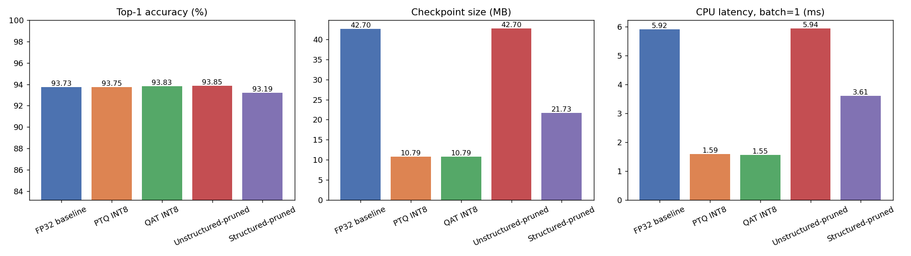
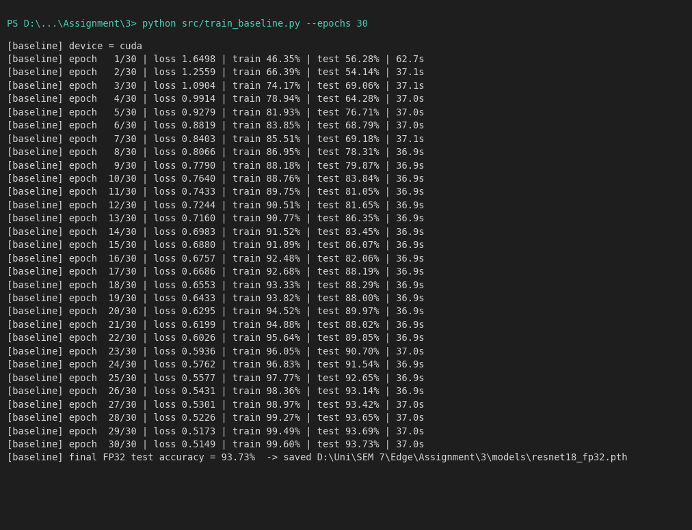
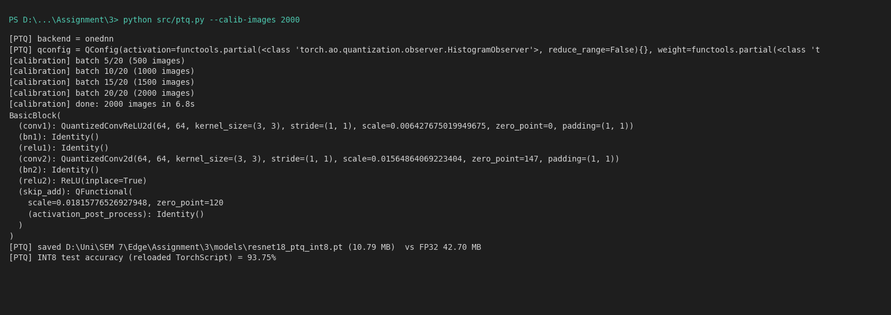
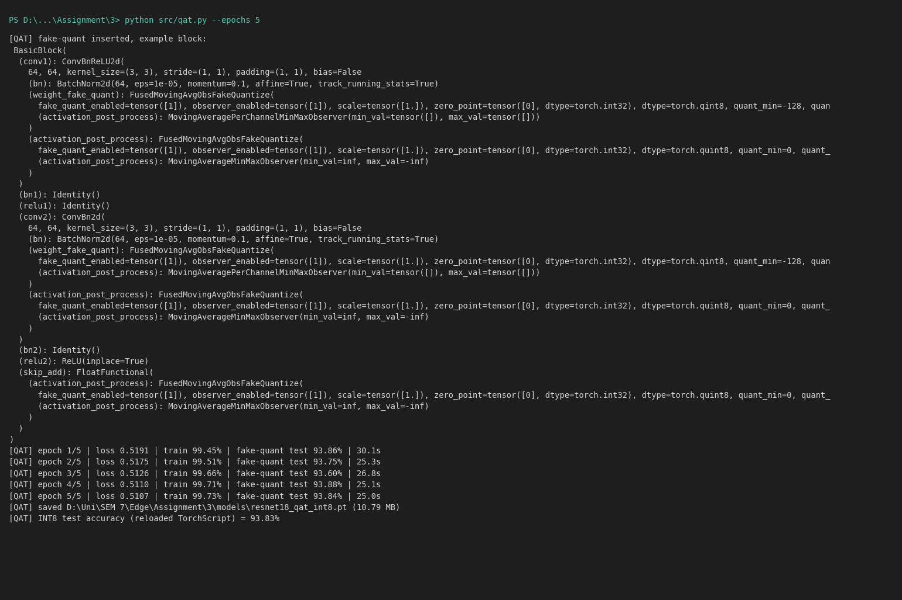
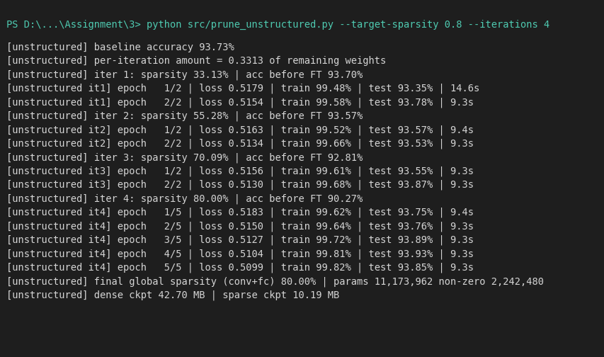
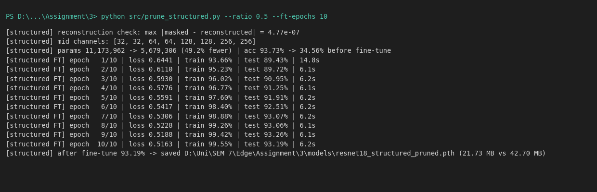
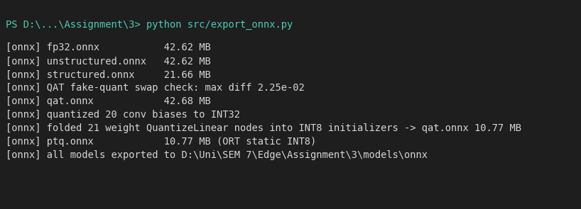
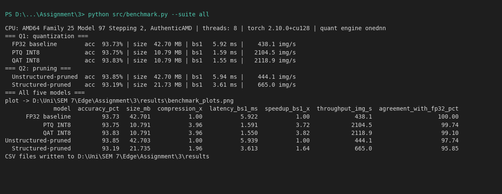
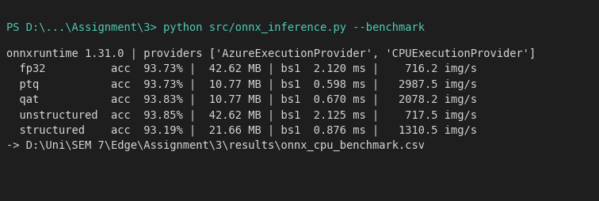
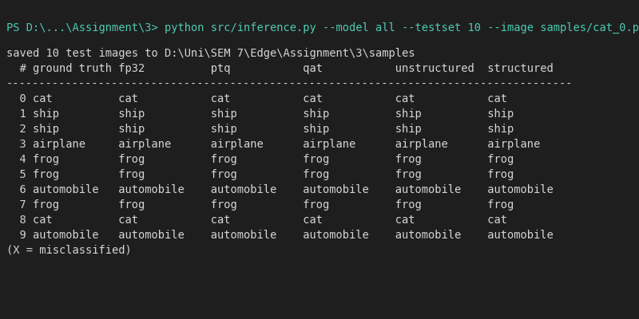

# Technical Report: Quantization and Pruning of ResNet-18 for Edge Deployment
**Course:** Edge Computing & Intelligent Systems, Assignment 3
**Dataset:** CIFAR-10 (50,000 train / 10,000 test, 32×32 RGB, 10 classes)
**Hardware:** AMD Ryzen 7 7700 (8 cores / 16 threads) for all inference benchmarks; NVIDIA RTX 5060 Ti 16 GB for training and fine-tuning
**Software:** Python 3.13.5, PyTorch 2.10.0+cu128, torchvision 0.25.0, ONNX 1.23.2, ONNX Runtime 1.31.0, Windows 11

---

## 1. Overview

One FP32 ResNet-18 is trained once and then compressed four ways. That gives the five deployable models below, all benchmarked on the same CPU and the same 10,000 test images:

```
                       ┌── PTQ  (fuse → observe → calibrate 2k imgs → convert)  → INT8 TorchScript ─┐
 CIFAR-10 ─► FP32 ─────┼── QAT  (fuse → fake-quant → fine-tune 5 ep → convert)  → INT8 TorchScript ─┤
 ResNet-18   baseline  ├── Unstructured (4× global L1 prune + fine-tune → 80% sparse, permanent) ────┼─► inference.py / benchmark.py (CPU)
             (30 ep)   └── Structured   (rank channels → rebuild smaller net → fine-tune) ─────────┤   export_onnx.py → ONNX Runtime CPU
                                                                                                    ┘
```

| Script | Purpose |
|---|---|
| `src/common.py` | Data pipeline, quantization-ready and prunable ResNet-18, train/eval/latency helpers, model loaders |
| `src/train_baseline.py` | FP32 training |
| `src/calibration.py`, `src/ptq.py` | Post-Training Static Quantization |
| `src/qat.py` | Quantization-Aware Training |
| `src/prune_unstructured.py`, `src/prune_structured.py`, `src/finetune.py` | Pruning and fine-tuning |
| `src/inference.py` | Inference pipeline for all 5 models |
| `src/benchmark.py` | Automated benchmark producing CSVs and plots |
| `src/export_onnx.py`, `src/onnx_inference.py` | ONNX deployment and CPU inference |
| `run_pipeline.ps1` / `run_pipeline.sh` | One-command reproducible pipeline |

## 2. Baseline model (Q1.1 / Q2.1)

**Architecture.** This is the CIFAR variant of ResNet-18: a 3×3 stride-1 stem and no max-pool, so the 32×32 input is not downsampled too early. It has 4 stages of 2 BasicBlocks (64-128-256-512 channels), global average pooling and FC-10, for 11.17 M parameters and 555.4 M MACs per image. The model is written to be quantization-ready from the start:
* `QuantStub` / `DeQuantStub` at the input and output;
* the residual addition uses `nn.quantized.FloatFunctional` (a plain `+` cannot be quantized in eager mode);
* each ReLU is a separate module (`relu1`, `relu2`), so `Conv+BN+ReLU` can be fused.

For structured pruning, the constructor takes `mid_channels` (the internal width of each block) so a smaller architecture can be rebuilt.

**Training.** 30 epochs, SGD (momentum 0.9, Nesterov, weight decay 5e-4), OneCycle LR with max 0.1, batch 256, label smoothing 0.1, and mixed precision (AMP). Augmentation is random crop (pad 4) plus horizontal flip.

**Data pipeline.** The whole dataset is held as a uint8 tensor on the GPU, and augmentation runs batched on the GPU (`common.TensorLoader`). This avoids the slow process spawning of Windows `DataLoader` workers.

**Pause/resume.** The full training state is saved after every epoch, so creating a `STOP` file pauses training cleanly.

## 3. Post-Training Static Quantization (Q1.2)

| Step | Implementation (`src/ptq.py`) |
|---|---|
| Fusion | `fuse_modules`: stem `[conv1,bn1,relu]`; in every block `[conv1,bn1,relu1]` and `[conv2,bn2]`; shortcut `[downsample.0, downsample.1]`. BN is folded into the conv weights and ReLU into the conv kernel, which removes 20 BN and 9 ReLU ops at run time. |
| Backend | `torch.backends.quantized.engine = "onednn"`; qconfig `get_default_qconfig("onednn")`: activations use a **HistogramObserver** (per-tensor affine, quint8); weights use a **PerChannelMinMaxObserver** (per-channel symmetric, qint8). |
| Calibration | `src/calibration.py` feeds 2,000 random **training** images (fixed seed, no augmentation, batches of 100) through the observed model. The test set is never used. |
| Convert | `torch.ao.quantization.convert` swaps in `QuantizedConvReLU2d`, `QuantizedConv2d`, `QFunctional` (INT8 add) and `QuantizedLinear`, which run real INT8 kernels. |
| Save / deploy | `torch.jit.script` → `models/resnet18_ptq_int8.pt` (self-contained, loads with `torch.jit.load` and needs no model code), plus the INT8 `state_dict`. The script reloads the saved file and evaluates it to confirm the deployment works. |

## 4. Quantization-Aware Training (Q1.3)

| Step | Implementation (`src/qat.py`) |
|---|---|
| Initialise | Start from the trained FP32 checkpoint. |
| Fuse | `fuse_modules_qat` produces `ConvBnReLU2d` / `ConvBn2d` QAT modules. BN stays live during training and is folded on the fly into the fake-quantized weight. |
| Fake quant | `prepare_qat` with `get_default_qat_qconfig("onednn")` inserts `FakeQuantize` modules on every weight and activation. They simulate INT8 rounding in the forward pass and use the straight-through estimator in the backward pass. |
| Fine-tune | 5 epochs, SGD with LR 1e-3 (cosine), batch 128, on the GPU in FP32. BN statistics are frozen after epoch 2 and the observers (scale/zero-point) after epoch 3. |
| Convert / export | Move to CPU, `convert`, and save TorchScript `models/resnet18_qat_int8.pt`. The fake-quant model is also saved, for the ONNX QDQ export. |

## 5. Unstructured pruning (Q2.2)

* **Criterion:** global L1 magnitude (`prune.global_unstructured`, `L1Unstructured`) over the weights of all 20 Conv2d layers and the FC layer. Ranking globally lets the redundant layers (the wide layer4 convs) be pruned harder than sensitive ones such as the stem.
* **Iterative schedule:** the target is S = 80% in N = 4 iterations. Each iteration prunes `a = 1 − (1 − S)^(1/N) ≈ 33.1%` of the *remaining* weights, giving cumulative sparsity 33.1% → 55.3% → 70.1% → 80.0%. Each iteration is followed by 2 epochs of fine-tuning (LR 0.01, cosine), with 3 extra epochs after the last.
* **Masking:** `torch.nn.utils.prune` re-parametrises each weight as `weight = weight_orig ⊙ weight_mask` (a forward pre-hook), so pruned weights stay exactly zero during fine-tuning.
* **Made permanent:** `prune.remove` bakes the mask into `.weight` and deletes `weight_orig`, `weight_mask` and the hooks. The checkpoint is then a plain `ResNet18` state_dict, and the script asserts that no `_mask` / `_orig` keys remain.
* **Compressed storage:** dense float tensors still store the zeros, so a second checkpoint stores a **1-bit packed mask plus the non-zero values**. The script includes a loader and a round-trip equality check.

## 6. Structured channel pruning (Q2.3)

* **Which channels:** in a ResNet the output channels of every block in a stage are tied together by the identity shortcut (`out = F(x) + x`). Removing one would mean removing it from every block and shortcut in that stage. The channel between `conv1` and `conv2` *inside* a BasicBlock is private: only `conv1/bn1` produce it and only `conv2` consumes it. We therefore prune those internal channels, which keeps every tensor shape valid.
* **Importance:** `s_c = ‖W_conv1[c]‖₁ · |γ_bn1[c]|`, the L1 norm of the filter scaled by the BN gain that multiplies its output. The 50% lowest-scoring channels of every block are removed: mid widths 64/128/256/512 become 32/64/128/256.
* **Reconstruction:** a **new** `ResNet18(mid_channels=[32,32,64,64,128,128,256,256])` is built, and the surviving weights are copied in: `conv1.weight[keep]`, `bn1.*[keep]`, `conv2.weight[:, keep]`. There are no masks and no zero channels, so parameters, FLOPs and latency really shrink.
* **Verification:** `check_dimensions()` asserts that every producer/consumer pair has matching channel counts and runs a forward pass. The script also checks that the reconstructed net gives the same output as the original net with those channels zeroed out (max difference about 1e-7).
* **Fine-tune:** 10 epochs, SGD with LR 0.02 (cosine).

## 7. Fine-tuning pipeline (Q2.4)
`src/finetune.py` provides one `finetune()` function that both pruning scripts call. It also works stand-alone (`python src/finetune.py --model structured --epochs 5`). In stand-alone mode with the unstructured model, it re-attaches masks built from the zero pattern so the sparsity is preserved during training.

## 8. Inference and benchmarking (Q1.4, Q1.5, Q2.5, Q2.6)
* `src/inference.py`: one `Predictor` class for all 5 models. It classifies any image file (resized to 32×32 and normalised), with top-3 predictions and latency, or the first N test images, with misclassifications marked.
* `src/benchmark.py`: evaluates all models on the **full 10,000-image test set on the CPU** and reports accuracy, checkpoint size (raw and gzip), batch-1 latency (mean and p95 over 200 runs after warm-up), batch-256 throughput, parameter count, sparsity, dense and effective MACs, speed-up versus FP32, and agreement with FP32 predictions. It writes:
  * `results/q1_quantization_benchmark.csv`, `results/q1_test_predictions.csv` (per-image prediction and confidence for FP32/PTQ/QAT)
  * `results/q2_pruning_benchmark.csv`, `results/q2_test_predictions.csv`
  * `results/all_models_benchmark.csv`, `results/benchmark_plots.png`

## 9. ONNX deployment
`src/export_onnx.py` produces `models/onnx/*.onnx`, and `src/onnx_inference.py` runs them with the ONNX Runtime **CPUExecutionProvider**. That needs only numpy, PIL and onnxruntime; no PyTorch or model code is required.

| Model | How it is exported |
|---|---|
| FP32, unstructured, structured | `torch.onnx.export`, opset 17, dynamic batch |
| QAT | The fake-quant model is exported as a **QDQ** graph. Three graph fixes were needed: (1) BN is folded at export time; (2) weight `QuantizeLinear` nodes are folded into INT8 initializers and conv biases quantized to INT32; (3) the residual `ReLU` is re-quantized with the add's qparams. With these, ONNX Runtime fuses all 20 convs into `QLinearConv` (see DEMO.md, Issue 4). |
| PTQ | ONNX Runtime `quantize_static` (QDQ, per-channel INT8 weights, uint8 activations) using the **same 2,000 calibration images** |

## 10. Experimental results

All numbers come from a single run of `run_pipeline.ps1` (13 Nov 2026), evaluated on the **full CIFAR-10 test set (10,000 images)**. PyTorch timings are on the CPU with 8 threads; batch-1 latency is the mean of 200 runs after warm-up.

### 10.1 Baseline training
The final FP32 test accuracy is **93.73%** after 30 epochs (1,147 s in total, about 37 s per epoch). The per-epoch log is in `results/baseline_training_log.csv`.

### 10.2 Q1: quantization (PyTorch, CPU, `results/q1_quantization_benchmark.csv`)

| Model | Top-1 acc. | Δ vs FP32 | Checkpoint | Compression | Latency bs=1 | Speed-up | Throughput (bs=256) | Same prediction as FP32 |
|---|---|---|---|---|---|---|---|---|
| FP32 baseline | **93.73%** | – | 42.70 MB | 1.00× | 5.92 ms | 1.00× | 438 img/s | 100% |
| PTQ INT8 | **93.75%** | +0.02 | 10.79 MB | **3.96×** | 1.59 ms | **3.72×** | 2,105 img/s (4.8×) | 99.74% |
| QAT INT8 | **93.83%** | +0.10 | 10.79 MB | **3.96×** | 1.55 ms | **3.82×** | 2,119 img/s (4.8×) | 99.10% |

QAT log (`results/qat_training_log.csv`): the fake-quant test accuracy was 93.86 / 93.75 / 93.60 / 93.88 / 93.84% over the 5 epochs, and the converted INT8 model scores 93.83%.

**Discussion**
* **Size.** INT8 weights cut the checkpoint by 3.96×, close to the theoretical 4×. The remaining bytes are the per-channel scales/zero-points, the FP32 bias and the TorchScript code.
* **Speed.** INT8 is 3.7–3.8× faster at batch 1 and 4.8× faster in throughput. onednn's INT8 convolutions use VNNI integer dot-product instructions, and fusion removes the 20 BN and 9 ReLU kernels completely.
* **Accuracy.** PTQ costs no accuracy for this model (93.75% vs 93.73%). ResNet-18 with BN folding, per-channel weight scales and histogram-calibrated activations is a well-conditioned case for 8-bit quantization. QAT is 0.08 pp higher than PTQ: fine-tuning with the rounding noise in the loop let the weights adapt to the quantization grid. The gap is small because PTQ already loses nothing. QAT's advantage typically appears at lower bit-widths or with harder architectures such as depthwise convs.
* **Agreement.** Although top-1 accuracy is equal, 0.26% (PTQ) and 0.90% (QAT) of individual predictions differ from FP32. QAT moves further from FP32 because its weights were *changed* by fine-tuning, not just rounded. The per-image predictions are in `results/q1_test_predictions.csv`.

### 10.3 Q2: pruning (PyTorch, CPU, `results/q2_pruning_benchmark.csv`)

| Model | Top-1 acc. | Δ vs FP32 | Params (non-zero) | Sparsity | MACs dense / effective | Checkpoint | Compressed storage | Latency bs=1 | Speed-up |
|---|---|---|---|---|---|---|---|---|---|
| Original FP32 | **93.73%** | – | 11.17 M | 0% | 555.4 M / 555.4 M | 42.70 MB | 39.52 MB (gzip) | 5.92 ms | 1.00× |
| Unstructured (80%) | **93.85%** | +0.12 | 2.24 M | **80.0%** (conv+fc) | 555.4 M / **281.6 M** | 42.70 MB | **10.19 MB** (bitmask) / 11.83 MB (gzip) | 5.94 ms | 1.00× |
| Structured (50% mid-channels) | **93.19%** | −0.54 | **5.68 M** | 0% (smaller network) | **281.7 M** / 281.7 M | **21.73 MB** | 20.12 MB (gzip) | **3.61 ms** | **1.64×** (throughput 1.52×) |

**Iterative unstructured pruning** (`results/unstructured_pruning_log.csv`):

| Iteration | Sparsity | Acc. right after pruning | Acc. after fine-tuning |
|---|---|---|---|
| 0 (baseline) | 0% | – | 93.73% |
| 1 | 33.1% | 93.70% | 93.78% |
| 2 | 55.3% | 93.57% | 93.53% |
| 3 | 70.1% | 92.81% | 93.87% |
| 4 | 80.0% | 90.27% | **93.85%** |

Pruning damage grows with each step (−0.03 → −3.6 pp before fine-tuning), but short fine-tuning recovers it every time. Doing it iteratively matters: a single cut to 80% would have to recover from a far larger drop at once.

**Per-layer sparsity from global magnitude pruning** (`results/unstructured_layer_sparsity.csv`). The global criterion pruned the wide, redundant late layers hardest and protected the small, sensitive early ones:

| conv1 (stem) | layer1 | layer2 | layer3 | layer4 | fc |
|---|---|---|---|---|---|
| 5.9% | 24–27% | 30–36% | 42–62% | 76–97% | 11.0% |

**Structured pruning.** The internal widths went from 64/64/128/128/256/256/512/512 to 32/32/64/64/128/128/256/256, so parameters dropped from 11.17 M to 5.68 M (−49.2%) and MACs from 555 M to 282 M. Accuracy fell to 34.56% right after removing the channels: removing whole filters is a far bigger change than zeroing small weights. 10 fine-tuning epochs recovered it to 93.19% (−0.54 pp).

**Discussion: unstructured vs structured**
* Unstructured pruning keeps accuracy best (93.85%, even +0.12 pp from the extra fine-tuning), and with sparse storage it gives a **4.2× smaller** file. But the **latency is unchanged** (5.94 vs 5.92 ms): the zeros still sit in dense tensors, and dense CPU conv kernels multiply by zero just as fast as by any other number. Turning 80% irregular sparsity into speed needs sparse kernels or hardware support (e.g. 2:4 sparse tensor cores), which these CPU kernels don't have.
* Structured pruning removes whole channels, so the result is an ordinary dense network that is **physically smaller**. Every runtime gets the speed-up automatically: 1.64× in PyTorch and 2.4× in ONNX Runtime (below), plus half the file size. The cost is a slightly larger accuracy drop (−0.54 pp) and the extra engineering needed to keep the residual connections' shapes consistent.

### 10.4 ONNX Runtime CPU deployment (`results/onnx_cpu_benchmark.csv`)

| ONNX model | Size | Top-1 acc. | Latency bs=1 | Speed-up vs FP32 ONNX | Throughput | Same prediction as FP32 |
|---|---|---|---|---|---|---|
| fp32.onnx | 42.62 MB | 93.73% | 2.120 ms | 1.00× | 716 img/s | 100% |
| ptq.onnx | 10.77 MB | 93.73% | **0.598 ms** | **3.55×** | 2,988 img/s | 99.68% |
| qat.onnx | 10.77 MB | 93.83% | 0.670 ms | 3.16× | 2,078 img/s | 99.02% |
| unstructured.onnx | 42.62 MB | 93.85% | 2.125 ms | 1.00× | 718 img/s | 97.74% |
| structured.onnx | 21.66 MB | 93.19% | 0.876 ms | **2.42×** | 1,311 img/s | 95.85% |

* The ONNX accuracies match the PyTorch models exactly (FP32, QAT, both pruned) or within 0.02 pp (PTQ, whose ONNX version uses ORT's own MinMax calibration). This confirms the exports are correct.
* ONNX Runtime is about 2.8× faster than eager PyTorch for the same FP32 network (2.12 vs 5.92 ms), thanks to graph optimisations and lower per-op overhead. That makes it the better deployment runtime on an edge CPU.
* INT8 models run as `QLinearConv` / `QLinearAdd` kernels (all 20 convs are fused; we checked by dumping the ORT-optimised graph).

### 10.5 Overall comparison



| Goal on an edge CPU | Best choice | Why |
|---|---|---|
| Lowest latency and smallest model | **PTQ INT8** | 4× smaller, 3.6–3.7× faster, no accuracy loss, and no training needed (16 s to produce) |
| Highest accuracy at INT8 | **QAT INT8** | +0.08 pp over PTQ, at the cost of 5 fine-tuning epochs |
| Faster without INT8 hardware support | **Structured pruning** | Real dense speed-up (1.6–2.4×), 2× smaller |
| Smallest storage / transmission at FP32 | **Unstructured pruning** + sparse encoding | 4.2× smaller file, but no speed-up on dense kernels |

The techniques are complementary. For example, the structured-pruned network could also be quantized to INT8, which would roughly give a 2× (pruning) times 4× (INT8) size reduction and stack the speed-ups.

## 11. Screenshots
Console output of every pipeline step, rendered from `logs/` by `src/make_screenshots.py`:

| Step | Screenshot |
|---|---|
| Baseline training |  |
| PTQ (fusion, calibration, convert, INT8 module printout) |  |
| QAT (fake-quant modules, fine-tuning, INT8 convert) |  |
| Iterative unstructured pruning |  |
| Structured pruning and reconstruction |  |
| ONNX export |  |
| Benchmark of all 5 models |  |
| ONNX Runtime CPU benchmark |  |
| Inference pipeline (all 5 models) |  |

## 12. Issues encountered
See `DEMO.md` → *Issues & Solutions* (the INT8 backend, the dataset download, sparse storage, and the QAT ONNX export). The design decisions are in `decisions/DECISIONS.md`.

## 13. Limitations and future work
* Single run with one seed. Differences under about 0.2 pp (e.g. PTQ vs QAT) are within run-to-run noise, so the main conclusion is "INT8 costs no accuracy here", not a strict ranking.
* Unstructured sparsity gives no speed-up with dense kernels. N:M (2:4) structured sparsity or a sparse inference engine would be needed.
* Next steps: combine structured pruning with QAT; prune the block outputs too (requires removing the same channels across a whole stage); per-layer sensitivity analysis to choose non-uniform pruning ratios.
